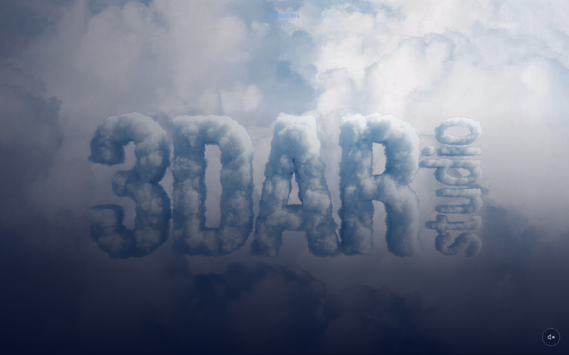
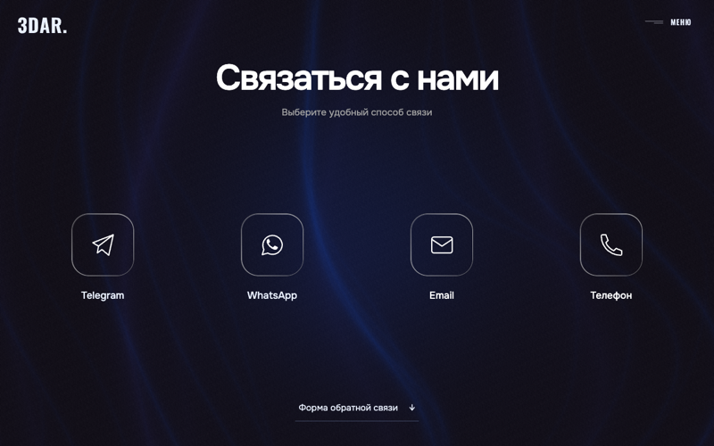
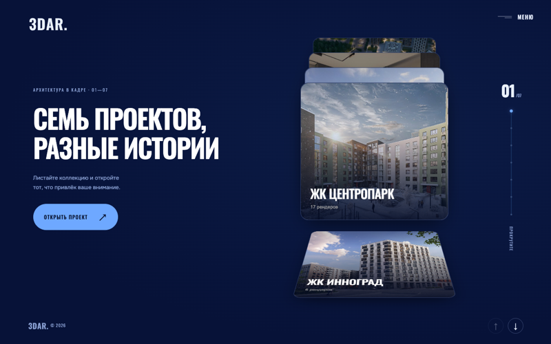

# STUDIO 3DAR website (public demo)

> **Public demo repository.** The repository root is the built static site served by GitHub Pages. **Source code is private; available on request** (zalyatovdamiredominic@gmail.com). Contact details on the contact page are placeholders; the site content is a pitch demo, not the studio's live site.

**Live demo:** <https://dominicdamire.github.io/3dar-studio-site-demo/>

Multi-page website for a 3D architecture-visualisation studio: scroll-driven video hero, a drifting wall of 55 renders, a project library and a film gallery. The text is in Russian. Pitched to a local business (not taken up).

## The problem

A visualisation studio sells on how its images feel, but a typical portfolio page is a grid of thumbnails. The brief was a site where the first screen already shows the craft: a hero film the visitor scrubs with the scroll wheel, and a wall of renders that can be browsed without leaving the page.

## Screens

## What it does

- **Home** (`index.html`): a 2560x1440 hero video driven by three scroll gestures (through the clouds, down to street level, along the facade; scrolling back up plays them in reverse) with a muted-by-default sound button. Then a statement section, a four-card service deck (3D visualisation, 3D animation, VR tours, brand solution), the drift wall of 55 renders, an about block, FAQ and contacts.
- **Projects** (`renders.html`): a scroll-driven stack of 7 project covers; opening one starts a full-screen viewer over all of that project's renders.
- **Animation** (`animation.html`): 15 film posters; clicking one loads a Kinescope player.
- **Contact** (`contact.html`, `feedback.html`): contact cards (placeholders here) and an enquiry form page that is preview-only (it shows a confirmation but sends nothing).
- **Flythrough** (`flythrough/`): a standalone 16-second courtyard-to-lobby render scrubbed by the scrollbar.
- A sliding menu (`site.js`) is injected into every page, and links between pages use a shared transition.

## Stack and architecture

Plain HTML, CSS and JavaScript pages with no framework and no backend. GSAP, OGL, three.js and `liquid-glass-react` effects are bundled with esbuild into `media/bundles/` (shipped prebuilt). The animation page's gallery in `mirror-hall/` renders with WebGL and falls back to canvas. The home page imports `@vfx-js/core` from esm.sh at runtime. In the private repository a small static server answers HTTP Range requests, because Chrome cannot seek a video without them.

## Differences from the source site

To fit the public upload, the two hero videos (`media/hero-sound.mp4`, `media/hero-sound-reverse.mp4`) and the flythrough video were re-encoded at the same resolution and with the same file names (H.264, shorter GOP, about 9 Mbit/s cap), so they are smaller and slightly softer than the originals. Unused video variants were left out. Contact details were replaced with placeholders.

## Tests

None in the repository: this is a static front end, checked by opening it in a browser at desktop and phone width.

Author: Damire Zalyatov
